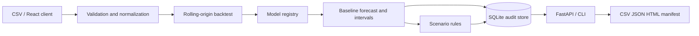

# Demand Planning Workbench

一套可在本機執行的需求預測與情境規劃平台。系統把銷售資料驗證、時間序列回測、
模型選擇、預測區間、情境調整、執行稽核及報告輸出串成一條可重現的全端工作流。

> 專案狀態：公司實務版 v1.0.0。預設 Demo 完全離線、零 API 費用；所有 Git 內範例
> 均為原創合成資料，不含私人資料、客戶資料或未授權素材。

## 使用情境、輸入與輸出

| 項目 | 定義 |
|---|---|
| 使用情境 | 零售或消費品規劃人員產生短期 SKU／地點需求預測並比較營運情境 |
| CSV 輸入 | `date, sku_id, location_id, units`；可選 `price, promo, stockout` |
| 核心處理 | 驗證 → 日序列補齊 → rolling-origin 回測 → 模型選擇 → 預測區間 → 情境規則 → 稽核 |
| 輸出 | 基準與情境預測、WAPE／MASE／Bias、警示、CSV／JSON／HTML 報告及 SQLite 紀錄 |
| 失敗策略 | 拒絕不合法列；歷史不足時使用安全基線並標記；不把情境調整宣稱為因果效果 |

## 已完成能力

- 嚴格驗證 UTF-8 CSV、必要欄位、日期、有限非負數值及布林旗標。
- 逐列記錄拒絕原因，同一 SKU／地點／日期重複資料會確定性彙總。
- 缺少日曆日期時補零並留下警示；stockout 會明示銷售可能低估潛在需求。
- 可擴充的模型 registry，以及 Seasonal Naive、Moving Average、Croston-SBA、Linear Trend。
- 依每條序列執行最多三折 rolling-origin 回測，以 WAPE 與 Bias 選擇模型。
- 保存所有候選模型的 WAPE、MASE、Bias、折數及 90% 殘差式區間。
- multiplier、additive、override 三種可依日期、SKU、地點套用的版本化情境規則。
- FastAPI、OpenAPI、SQLite 稽核資料庫、CSV 匯出及自包含 HTML 報告。
- React／TypeScript 儀表板：上傳、圖表、模型證據、情境比較、歷史執行及下載。
- CLI、離線 Demo、效能基準、SHA-256 manifest 與輸出竄改驗證。
- 後端單元／整合／API／端到端測試、前端互動測試、CI 與隱私掃描。

## 架構



核心模型不依賴 API 或資料庫；FastAPI、CLI 和報告層都使用同一個 application service，
避免在不同入口重複商業規則。元件責任、SQLite schema 及故障邊界見
[`docs/ARCHITECTURE.md`](docs/ARCHITECTURE.md)。

## 五分鐘離線 Demo

需求：Python 3.11+、Node.js 24+、pnpm 11、Git。Windows PowerShell：

```powershell
python -m venv .venv
.\.venv\Scripts\Activate.ps1
python -m pip install --upgrade pip
python -m pip install -e ".[dev]"
pnpm --dir frontend install --frozen-lockfile
.\scripts\run-demo.ps1
```

輸出位於 `outputs/demo`：

- `forecast.csv`：每條序列、日期、點預測、上下界與模型。
- `summary.json`：完整執行、模型分數、警示、拒絕列及輸入雜湊。
- `report.html`：可直接開啟的自包含報告。
- `manifest.json`：所有展示產出的 SHA-256 與位元組數。

驗證產出未被修改：

```powershell
python -m demand_workbench verify-output outputs/demo
```

## 啟動全端介面

終端一：

```powershell
.\.venv\Scripts\Activate.ps1
python -m demand_workbench serve
```

終端二：

```powershell
cd frontend
pnpm dev
```

瀏覽 `http://127.0.0.1:5173`。選擇 [`examples/sales.csv`](examples/sales.csv)，建立預測後
即可比較情境。API 文件在 `http://127.0.0.1:8000/docs`。本機展示沒有正式身分驗證，
CLI 因此只允許 loopback host。

## CLI 與 API

```powershell
python -m demand_workbench doctor
python -m demand_workbench run --input examples/sales.csv --horizon 14
python -m demand_workbench benchmark --input examples/sales.csv --iterations 100
python -m demand_workbench serve --host 127.0.0.1 --port 8000
```

主要 REST endpoints：

| Method | Path | 用途 |
|---|---|---|
| GET | `/api/health` | 版本、資料庫及模型 registry 診斷 |
| POST | `/api/runs/csv` | 送入 UTF-8 CSV 並建立預測執行 |
| GET | `/api/runs`、`/api/runs/{id}` | 執行清單及完整證據 |
| GET | `/api/runs/{id}/forecast.csv` | 匯出基準預測 |
| POST | `/api/runs/{id}/scenarios` | 建立並保存情境 |
| GET | `/api/scenarios/{id}` | 讀取情境與差異 |

## 公開資料評估

選配資料為 UCI Online Retail II，CC BY 4.0，約 43.5 MB。資料與轉換輸出均留在
`data/raw`，不提交 Git：

```powershell
python -m pip install -e ".[data]"
.\scripts\download-uci-dataset.ps1
.\scripts\prepare-uci-dataset.ps1 -TopSkus 12
python -m demand_workbench run `
  --input data/raw/uci-online-retail-ii/daily-sales.csv `
  --horizon 28 --output-dir outputs/uci-evaluation
```

本機實測轉換 1,067,371 筆來源交易，篩出活躍日覆蓋最高的 12 個 SKU，形成 6,928 筆
日彙總。選定模型的平均 WAPE 為 82.84%、中位 WAPE 82.53%；20 次 CSV→預測基準的
中位時間 64.71 ms、p95 73.05 ms，約每秒 107,070 筆輸入。數字顯示流程可重現，
但錯誤率也明確表示簡單基線不適合直接生產部署。詳細來源、SHA-256、方法與限制見
[`docs/DATASET.md`](docs/DATASET.md)。

## 測試與完整驗證

```powershell
.\scripts\verify.ps1
```

驗證腳本依序執行：

- Python dependency check、compileall、Ruff、Mypy。
- Pytest 單元、資料庫、API、CLI、報告與情境測試及覆蓋率。
- pnpm frozen install、TypeScript typecheck、Vitest 及 Vite production build。
- Runtime doctor、追蹤檔大檔案／密鑰／私人路徑掃描。

## 專案結構

```text
src/demand_workbench   領域模型、輸入、預測、情境、SQLite、API、CLI、報告
frontend               React、TypeScript、Vite 操作介面
tests                  單元、整合、API、CLI 與端到端測試
examples               可直接執行的原創合成 CSV
tools                  公開資料去識別日彙總轉換工具
scripts                Demo、驗證、隱私、下載與資料準備入口
docs                   架構、資料集、Demo 與限制
data/raw               公開大型資料；Git 忽略
outputs                SQLite、報告及基準產物；Git 忽略
```

## 安全與公開邊界

- `.env`、資料庫、公開資料原檔、執行輸出、log、前端產物及快取均由 Git 忽略。
- API 限制單次 CSV 為 5 MiB；CLI 適用較大的本機批次。
- UCI 轉換只輸出日期、商品代碼、國家、彙總數量與均價，不輸出顧客 ID 或描述。
- 報告保存輸入及產出 SHA-256，但不保存原始 CSV 內容。
- 專案只建立本機 Git，沒有部署、上傳或建立外部資源。

## 限制與下一步

- 公開資料是銷售，不是未受缺貨限制的潛在需求；缺少日曆日補零也是資料契約假設。
- `price`、`promo` 目前被驗證與保留在輸入層，但 v1 模型尚未當作外生變數使用。
- 情境規則是透明的 deterministic overlay，不是促銷 uplift 或因果模型。
- 預測區間來自回測殘差分位數，沒有正式覆蓋率保證。
- 尚無階層式 reconciliation、庫存／lead time／service level 或補貨最佳化。
- SQLite 與 loopback API 適合單機作品展示；正式多人環境需 PostgreSQL、佇列、OIDC 與權限。

完整技術邊界與後續優先順序見 [`docs/LIMITATIONS.md`](docs/LIMITATIONS.md)。

## 授權

專案原始碼與原創範例採 MIT License。第三方套件及資料來源見
[`THIRD_PARTY_NOTICES.md`](THIRD_PARTY_NOTICES.md)。
